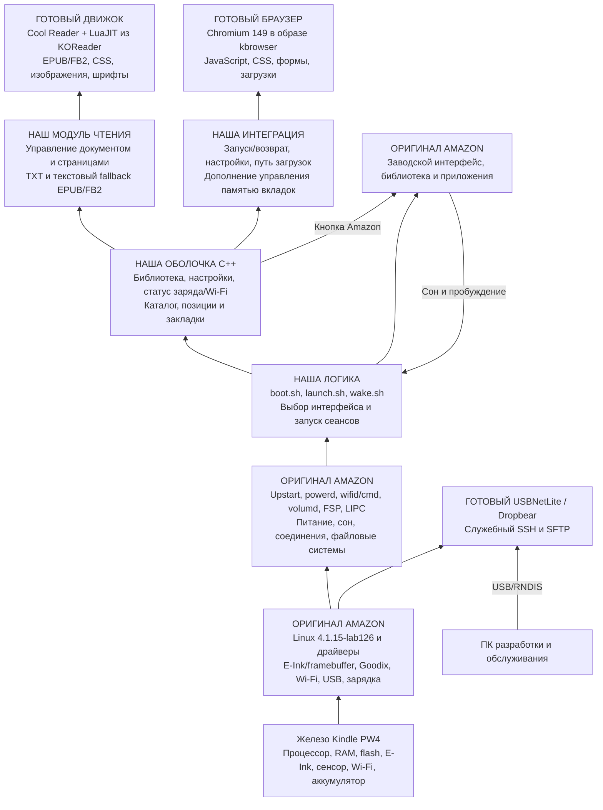
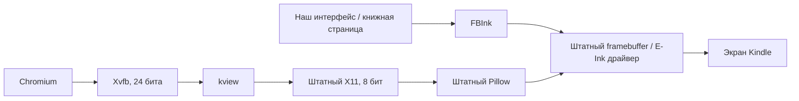
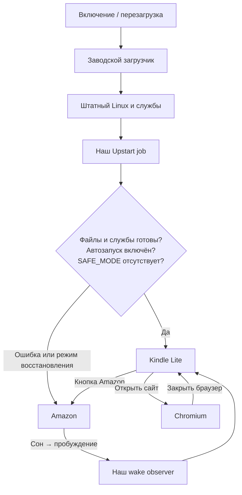

# Устройство Kindle Lite 0.2

Kindle Lite использует заводское ядро Linux и драйверы Paperwhite 4. Наша
пользовательская среда управляет библиотекой, чтением, запуском браузера и
переключением в Amazon. В схеме нижние блоки предоставляют возможности верхним.

Заводской загрузчик при включении загружает штатное ядро. Менять загрузчик
или разметку разделов для текущей среды не требуется. Образ браузера — файл
с Linux-программами для chroot. Chromium работает на том же ядре Kindle.

## Что сохранено, что изменено

| Компонент | Происхождение | Состояние в 0.2 |
| --- | --- | --- |
| Загрузчик, ядро и разметка памяти | Заводская прошивка Amazon | Сохранены |
| Драйверы экрана, сенсора, Wi-Fi, USB и аккумулятора | Заводская прошивка Amazon | Сохранены, используются через существующие интерфейсы Linux |
| powerd, сетевые службы, volumd, FSP, LIPC и Upstart | Заводская прошивка Amazon | Используются для питания, сна, соединений, хранения и управления процессами |
| X11 и Pillow | Заводская прошивка Amazon | Используются в графическом пути полноценного браузера |
| Интерфейс Amazon и штатные приложения | Заводская прошивка Amazon | Хранятся на устройстве и доступны через кнопку Amazon. Во время нашей сессии lab126_gui остановлен |
| Автоматический старт lab126_gui | Заводская конфигурация Upstart | Строка start on закомментирована, оригинал сохранён. Прямой запуск Amazon выполняет наш launcher |
| Автоматический старт otaupd и otav3 | Заводские службы обновлений | Строки start on отключены, исполняемые файлы сохранены |
| rcm | Заводская служба | Приостанавливается на время нашей сессии и восстанавливается, если до этого работала |
| Основной интерфейс по умолчанию | Наш C++ код | Kindle Lite открывается при запуске. Отдельный observer возвращает его после сна из Amazon |
| Каталог, навигация чтения и состояние | Наш C++ код | Хранят книги, позиции, закладки и настройки |
| Вывод оболочки на E-Ink | FBInk, установленный с MRPI | Готовый открытый компонент. Наш код готовит изображения и команды вывода |
| Служебное подключение к ПК | USBNetLite и Dropbear | Готовый SSH/SFTP. Наш скрипт ожидает USB-интерфейс и помогает запуску службы; известная проблема повторного подключения описана в журнале релиза |
| Книжная верстка | Cool Reader и LuaJIT из пакета KOReader | Готовый движок. Наш worker получает страницы и передаёт их нашей оболочке. Интерфейс KOReader не запускается |
| Полноценный браузер | Chromium и kbrowser | Готовые открытые компоненты, запускаемые нашей средой |
| Среда запуска браузера | Alpine Linux userland в образе kbrowser | Дополнительные библиотеки и программы внутри chroot. Используется штатное ядро Kindle |
| Шрифт оболочки | Bookerly из заводской прошивки | Читается с устройства. Файл шрифта не включён в наш архив |
| Клавиатура и панель браузера | TouchKit из kbrowser | Используются с изменением раннего запуска и нашим дополнением выгрузки вкладок |
| Процент заряда и Wi-Fi | Данные заводских драйверов, наш вывод | Читаются из sysfs/procfs. Отдельное обновление небольшой области экрана |

В 0.2 заменены основной пользовательский интерфейс и порядок его запуска.
Заводские компоненты прошивки сохранены на устройстве. Текущие изменения
включают остановку отдельных процессов и редактирование стартовых правил.

## Два пути вывода изображения

Наш интерфейс читает сенсор через evdev и освобождает его при переходе в
полноценный браузер. После закрытия браузера launcher снова запускает оболочку.
Системный Lua power bridge сообщает powerd о работающем интерфейсе во время
остановки Amazon. Перед возвращением Amazon этот bridge завершается.

## Запуск и переключение

Восстановление при ошибке служит отдельным путём запуска. При уже открытой нашей
сессии observer сохраняет её. Возврат после пробуждения проверялся с USB-кабелем.
Длительная автономность и глубокий сон без кабеля ещё требуют измерений.

## Где находятся файлы

| Путь на Kindle | Назначение |
| --- | --- |
| /mnt/us/kindle-lite/ | Наша оболочка, скрипты и конфигурация |
| /mnt/us/kindle-lite/books/ | Библиотека TXT/EPUB/FB2 |
| /mnt/us/kindle-lite/books/Downloads/ | Новые загрузки браузера |
| /mnt/us/kindle-lite/runtime/ | Каталог, настройки, позиции, кеши и журналы |
| /mnt/us/kindle-lite/engines/koreader/ | Дополнительные библиотеки и LuaJIT |
| /mnt/us/kbrowser/kbrowser.ext3 | Образ среды Chromium |
| /etc/upstart/kindle-lite.conf | Наш запуск после старта x |
| /etc/upstart/kindle-lite-wake.conf | Наш возврат после пробуждения |
| /mnt/us/kindle-lite/runtime/install-backup/ | Оригиналы изменённых Upstart-конфигураций |

Исходники основных частей находятся в [оболочке](../src/ui/kindle.cpp),
[модуле чтения](../src/reader/native.cpp), [worker верстки](../scripts/kindle-reader-worker.lua),
[launcher](../scripts/kindle-launch.sh), [wake observer](../scripts/kindle-wake.sh)
и [индикаторах](../src/core/device_status.cpp). Версии внешних движков и их
контрольные суммы закреплены в [манифесте](../config/optional-engines.json).
